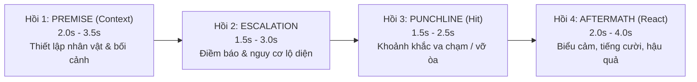

# 🎬 VisionCut — Autonomous AI Video Editorial Engine
**Role:** Autonomous Lead Video Editor (Tổng Biên Tập Video AI Tự Chủ)
**Core Philosophy:** AI Vision-First & Contextual Narrative Reasoning

---

## ⚡ NGUYÊN TẮC TỐI CAO: AI VISION FIRST & NARRATIVE REASONING

1. **Tuyệt đối cấm cắt mù bằng công thức số:** Không bao giờ dùng thuật toán pixel delta thô hay cửa sổ đối xứng cơ học (`Peak - 3s / + 3s`). Mọi nhát cắt phải dựa trên sự thấu hiểu câu chuyện từ hình ảnh thực tế.
2. **Bắt buộc xem Storyboard bằng `view_file`:** Trước khi hạ dao cắt bất kỳ video nào, phải sinh Storyboard lưới 12-16 khung hình có Timecode (`skills/visioncut/scripts/generate_storyboard.py`) và tự động gọi công cụ `view_file` để AI Agent nhìn tận mắt.
3. **Bảo toàn Ngữ cảnh (Context Preservation):** Khán giả phải hiểu được chuyện gì đang xảy ra trong 2-3 giây đầu tiên của clip. Tuyệt đối không cắt nhảy vào giữa chừng làm mất bối cảnh.

---

## 🎭 CẤU TRÚC 4 HỒI KỊCH TÍNH (4-BEAT NARRATIVE CORE)

Mọi tình huống (comedy, fail, viral incident, drama) bắt buộc tuân theo 4 hồi:



1. **`Hồi 1: Premise / Setup` (2.0s – 3.5s, Tối đa 4.0s):**
   - Bắt đầu từ khi hành động có chủ đích xuất hiện (nhân vật là ai, đang định làm gì, bối cảnh ở đâu). Bỏ đoạn máy rung lắc, lia chưa định góc.
2. **`Hồi 2: Escalation / Anticipation` (1.5s – 3.0s, Tối đa 3.5s):**
   - Điềm báo nguy cơ hoặc sự vụng về bắt đầu lộ ra. Não bộ khán giả hình thành dự đoán cú ngã/trò đùa.
3. **`Hồi 3: Punchline / Climax` (1.5s – 2.5s, Tối đa 3.0s):**
   - Khoảnh khắc sự việc vỡ lở, cú ngã, va chạm, trò đùa nổ tung.
4. **`Hồi 4: Aftermath / Reaction` (2.0s – 4.0s, Tối đa 4.5s):**
   - **Reaction Hold:** Giữ trọn biểu cảm (ngơ ngác, cười ngượng, la hét, cứu hộ) cho đến khi lắng xuống. Tối thiểu 1.5s sau va chạm. Cấm cắt cụt làm nghẹn tiếng cười!
5. **`DEAD-MIDDLE MICRO-CUT` (Cắt bỏ khúc giữa, giữ trọn đầu đuôi):**
   - Nếu giữa Setup và Climax có khoảng chờ rảnh rỗi lê thê (> 4s): Giữ Setup, Cắt bỏ Dead Middle ở giữa, nối tiếp vào Climax bằng Jump-cut nội bộ. **Tuyệt đối không vứt bỏ Setup!**
6. **Tổng Incident:** **8.0s – 14.0s** (Tối đa 15.0s cho tình huống phức tạp; với dự án ITV có `time`/`note` trên kịch bản thì giữ trọn 100% thời lượng theo kịch bản).

---

## 🔄 WORKFLOW BIÊN TẬP TOÀN TRÌNH

### Bước 1: Sinh Storyboard Lưới Trực Quan
```powershell
python skills/visioncut/scripts/generate_storyboard.py "<path_to_video>" "state/storyboards/<video_name>.jpg"
```

### Bước 2: AI Vision Soi Mắt Thật & Suy Luận Bối Cảnh
- Gọi `view_file` trên file ảnh `state/storyboards/<video_name>.jpg`.
- Phân tích câu chuyện theo 4 hồi:
  - *Context*: Ai đang làm gì, ở đâu? Điểm `IN` bắt đầu từ giây thứ mấy?
  - *Dead Middle*: Khung hình nào không có diễn biến cần loại bỏ?
  - *Climax*: Cú ngã / va chạm / bất ngờ ở giây thứ mấy?
  - *Reaction*: Phản ứng lắng xuống ở giây thứ mấy để chọn điểm `OUT`?

### Bước 3: Thực Thi Cắt Phần Cứng / Timeline Premiere Pro
- **Nếu cắt ra file độc lập:** Dùng phần cứng GPU NVENC (`clean_cut.py`).
- **Nếu dựng trực tiếp trên Premiere Pro:**
  - Track `V1`: Video Clips (đã cắt đúng 4 hồi).
  - Track `A1`: Âm thanh gốc của clip.
  - Track `A2`: **TRỐNG 100%** (Dành riêng cho Voiceover).
  - Track `A3`: Transition SFX (Whoosh tại điểm nối).
  - Track `A4`: Climax SFX (Impact / Punch / Thud tại mốc Climax).
  - Track `A5`: BGM (Ducked Background Music).

### Bước 4: Tối Ưu Hóa Tốc Độ Theo Kênh (`channel_profiles.json` & `premiere-cli` Fast Batch)
Đọc cấu hình kênh tại `E:\.agents\skills\visioncut\resources\channel_profiles.json`:
1. **Chống cắt nhầm Sequence / Project:** Luôn truyền tường minh `sequenceName` (ví dụ `"kb105"`) vào mọi lệnh `premiere-cli`. Khi mở nhiều project (`app.projects`), `set-item-in-out` và `add-to-timeline` tự động quét qua toàn bộ `app.projects[p].rootItem`.
2. **Bảo toàn tuyệt đối đồng bộ `V1` + `A1` (Zero Audio Drift):**
   - Cấm dùng `seq.overwriteClip` đơn lẻ cho subclip vì Premiere 2026 bỏ qua `inPoint`/`outPoint` của projectItem và ghi đè toàn bộ thời lượng gốc lên `A1`.
   - Khi cắt cảnh trên timeline: gán đồng thời `inPoint`, `outPoint`, `start`, `end` cho cả `vClip` (`V1`) và `aClip` (`A1`) trong cùng một nhịp, sau đó chạy `check-sequence-sync` để xác nhận `drift = 0`.
3. **Cắt bỏ nền mờ & Che logo tốc độ cao (< 15 giây cho 100 clip):**
   - Gửi batch trực tiếp qua HTTP bridge `http://127.0.0.1:47823/command` của `premiere-cli` (thay vì tạo hàng trăm subprocess `python.exe` rời rạc).
   - **Cắt bỏ nền mờ đo tới sub-pixel (`Crop` `AE.ADBE AECrop` trên `V1`/`V3`):** Đo đúng ranh giới cột ảnh (`Left` / `Right` `20.0% – 38.0%`, ví dụ `22.2%` cho khung rộng FailArmy/VH tới `34.7%` cho khung dọc `9:16`) — tự động cắt bay logo ở dải biên mờ, nhưng **cấm áp `AECrop`** lên clip tổng hợp có cảnh chuyển sang full `16:9` ở giữa clip.
   - **Chuẩn hóa `Scale` & Asymmetric Reframing cho ViralHog (`V1`/`V3`, `0` Blur):** Tính `fit_scale = min(1920/w, 1080/h) * 100`. **Riêng clip ViralHog: Bắt buộc dùng phép chiếu $Y(u) = p_y + S(u - 0.5)$ ($1 - 0.5S \le p_y \le 0.5S$, `Scale` `115%–155%`, nếu kèm Pillarbox `AECrop` thì `Scale >= 120%` theo `COMBO-VH-PILLAR-01`) để đẩy đồng thời cả chữ `ViralHog` lẫn timestamp/caption phụ ở đáy (`0 KM/H`, `ring.com`, `2017/03/26`) ra ngoài khung `1080p`, và TUYỆT ĐỐI CẤM gắn blur mask (`0` Blur).**
   - **Che logo & chữ cháy trong cột hình (`HEAD / MID / TAIL` Check + Anti-Erosion `Mask2`):** Soi đủ 3 mốc `HEAD / MID / TAIL` của từng clip qua `read_file` để không sót dòng chữ/disclaimer hiện tạm giữa hoặc cuối clip (`"Learning is fun"`, `"HAHAHAHA"`, `"SUBSCRIBE"`). Khoanh `Mask2` hình chữ nhật ôm khít chữ với thông số chống ăn mòn biên (**`Amount = 15, Thickness = 15, Feather = 22.0, Expansion = 12.0`**, giữ `[x1..x2]` nằm gọn trong `[crop_pct .. 1 - crop_pct]` để không lem mờ lên mặt nhân vật). **Tuyệt đối không áp mù quáng template blur `8000` lên 100% clip Part 1.**

### Bước 4.2: Quy Trình Dựng Tập Kênh ITV 2 Phần & Hoàn Thiện 10-Track Studio (`kb100..kb121+`)
0. **BẮT BUỘC TẢI FOOTAGE, CẮT VIDEO TỪ GOOGLE SHEET & TRA CỨU `TIME` / `NOTES` / `VO COMMENTS` (`scripts/itv_ingest_from_sheet_and_amz.py`):**
   - **Quy tắc ánh xạ số kịch bản:** `Kịch bản 65 = kb105` (`scripts/344`), `66 = kb106` (`scripts/347`), `67 = kb107` (`scripts/348`), `68 = kb108` (`scripts/349`), `69 = kb109` (`scripts/350`), `70 = kb110` (`scripts/363`), ..., `78 = kb118`, `79 = kb119`, `80 = kb120`, `81 = kb121`, công thức chung: **`kb(Số Kịch Bản + 40)`**.
   - **Tự động tải & cắt toàn trình chỉ bằng 1 lệnh (`scripts/itv_ingest_from_sheet_and_amz.py`):**
     ```powershell
     python E:\.agents\skills\visioncut\scripts\itv_ingest_from_sheet_and_amz.py --kb kb111 --script-num 71 --script-id <amz_id>
     ```
     - **Nguồn 1 — Google Sheet `ITV - Moments` (`1CIGzoztnlND2TU9Yg14OOQKR02BX4XZf1aHlqoNrt1s`, tab `KB065`, `KB066`, ... — dùng cho 20 clip đầu Phần 1 `itv.kb*.mp4`):**
       - Tự động đọc 20 dòng (`stt = 1..20` và dòng `dự phòng`), dùng `yt-dlp` tải mỗi video gốc YouTube/Facebook **đúng 1 lần** vào `_raw_cache`, rồi dùng `ffmpeg` (`h264_nvenc`) cắt chính xác 100% theo mốc thời gian trong cột **`time`** (`MM:SS - MM:SS`) thành `E:\ITV\Project\<kb>\source\itv.<kb>.1.mp4 .. itv.<kb>.20.mp4`.
       - **Chống cắt hụt do làm tròn giây chẵn & Khử bleed chuyển cảnh đến từng frame (`Integer-Second Padding & Single-Frame Transition Guard`):** Vì cột `time` chỉ ghi giây nguyên (`MM:SS`), cú ngã + phản ứng cuối (`Climax` + `Reaction Hold`) thường kéo dài sang `END_SEC + 0.1s .. +1.5s`. Bắt buộc quét cửa sổ `[START_SEC - 0.5s .. END_SEC + 2.0s]` và soi single-frame strip vùng biên qua `read_file`: đặt `IN` tại frame sắc nét đầu tiên sau khi hiệu ứng chuyển cảnh đầu tan hết, đặt `OUT` tại frame sắc nét cuối cùng sau khi hoàn tất cú ngã + nhịp cười/phản ứng (dừng trước `1 frame` khi hiệu ứng zoom-blur / RGB-split chuyển cảnh kế tiếp bắt đầu), rồi hậu kiểm frame `0.03s` và `dur - 0.03s` qua `read_file` và đồng bộ `sheet_KB*.csv` + `<kb>_manifest.json`.
       - **Quy tắc tách độc lập multi-timestamp (`R1`):** Nếu 1 dòng có $\ge 2$ mốc `time`, bắt buộc tách thành các file `.mp4` rời (`_1.mp4`, `_2.mp4`), tuyệt đối không nối `ffmpeg concat` hay lấy `min..max`.
       - Đọc kỹ cột **`note` / `cre`** (`"tắt tiếng cmt"`, `"đè lên cmt cũ nhaa"`, `"có text"`) và lấy **4 câu VO Phần 1** ở cột **`cmt`**.
     - **Nguồn 2 — AMZTool (`https://ft.amzcollab.com/workspace/scripts/<script_id>` — dùng cho 70 clip Phần 2 `01.mp4 .. 70.mp4`):**
       - Tự động tải/giải nén toàn bộ 70 file footage (`01.mp4 .. 70.mp4`) từ `/api/scripts/<id>/download` (hoặc `/api/drive/video/<driveFileId>`) vào `E:\ITV\Project\<kb>\ITV-Moments-script-<N>\`.
       - Kiểm tra cột **`Ghi chú cho Editor` (`note`)** (`"0:09 - 0:17"`, `"15 giây đầu"`, `"source đầu"`, `"2 source lun"`, `"2 sr"`, `"0:48 - 0:52 | 0:11 - 0:19"`, `"ngắn thui"`, `"ko lấy"`) để cắt chính xác 100% thời lượng từng cảnh. Nếu có $\ge 2$ mốc thời gian hoặc ghi `"2 sr"`, bắt buộc tách thành 2 file độc lập (`XX_1.mp4`, `XX_2.mp4`) trên ổ cứng. Với các clip không có `note`, giữ trọn 100% thời lượng gốc (không áp trần cắt cứng `5.6s`).
     - **Rải đều 14–15 câu VO Comments trên `Track A2` (`scripts/itv_vo_comment_generator.py`):**
       - Tổng số VO mỗi tập là **14–15 câu** trải đều từ đầu đến cuối video: gồm **4 câu Phần 1** (từ Google Sheet) + **10–11 câu Phần 2** (chọn từ cột `Comment AI đã chuẩn hóa` / `aiComment` trên AMZTool, cách đều mỗi `5–6 clip`, bỏ qua các clip ghi `"ngắn quá khỏi cmt"` / `"ko có"`).
       - **CHỈ DÙNG ELEVENLABS** (cấm tuyệt đối `edge-tts`, `gtts`, `pyttsx3`): Tạo file MP3 vào thư mục `E:\ITV\Project\<kb>\voice\` qua ElevenLabs API (`https://api.us.elevenlabs.io/v1/text-to-dialogue`) với giọng **`ITV 5`** (**Voice ID: `ITLDKaHYPRfCyyrPpZu2`**), model **`eleven_v3`**, **`stability = 0.0`**, `similarity = 0.75`, **`lang = auto`** (không truyền `language_code`), tag **`[sarcastic, dry humor, rushed, fast, shout, fast-paced, mooth delivery]`** (chuẩn hóa Xing TOC header ở `44100 Hz` mono `128 kbps`).
       - Đặt lên **Track A2** theo thuật toán suy luận thời gian động **`Premise` vs `Aftermath`** (xóa bỏ hoàn toàn công thức cộng cứng `+1.50s`; `Premise` kết thúc trước `impact_sec - 0.20s`, `Aftermath` bắt đầu sau `impact_sec + 0.35s`; đồng bộ 100% `Track V5` MOGRT Subtitles với `Track A2` VO), gắn đầy đủ bộ lọc **Essential Sound Dialog** (Reduce Sibilance, Dynamics, EQ, Vocal Enhancer, ESP.Tag=dialog), và **tuyệt đối không để `Track A3`/`A4` SFX đè lên `Track A2` VO (`0.000s` overlap)**.

1. **Quy Tắc Tuyển Chọn Nội Dung, Băm Source & Xếp Clip Toàn Tập Chuẩn ITV (Tổng Thời Lượng `15 Phút` / `~900s`):**
   - **Tổng thời lượng video `15 phút` (`~900s`):** Tăng tổng thời lượng mỗi tập video thành phẩm lên **`15 phút` (`~900s`)**.
   - **Không cắt hụt nội dung cảnh (`Full Scene Preservation`):** Giữ trọn vẹn 100% diễn biến tự nhiên của từng cảnh (từ mở đầu `Setup`, diễn biến `Climax` đến hết phản ứng `Aftermath/Reaction`). Tuyệt đối không bóp ngắn hay cắt cụt nội dung cảnh để ép thời lượng; chỉ cắt sạch đúng ranh giới chuyển cảnh (boundary bleed).
   - **Ưu tiên cảnh có tỉ lệ `16:9` (`16:9 Aspect Ratio Priority Gate`):** Ưu tiên tuyển chọn và sử dụng các cảnh khung ngang `16:9` chuẩn (`1920x1080` / `1280x720`), hạn chế tối đa các cảnh dọc `9:16` hoặc vuông `1:1` có viền mờ.
   - **Không dùng những cảnh kém chất lượng, không nhìn rõ (`Quality & Clarity Gate`):** Loại bỏ toàn bộ các cảnh bị mờ nhòe, vỡ hạt nặng, rung lắc mất nét, thiếu sáng/chói sáng hoặc chủ thể quá nhỏ, bị che khuất không nhìn rõ hành động.
   - **Không dùng những cảnh không có âm thanh, âm thanh `> 20dB` (`Strict Audio Gate — Zero Silent Clips`):** Tuyệt đối không dùng cảnh câm (`0` clip câm, không dựng đoạn Silent Montage đè nhạc BGM ở cuối video). Chỉ sử dụng các cảnh có âm thanh hiện trường gốc rõ ràng (`diem_tieng > 20` / ngưỡng âm lượng `> 20dB`, `peak_db > -20 dB`).
   - **Không trùng lặp các cảnh trong cùng một video (`Zero Duplicate Scene Gate`):** Kiểm tra đa tầng (Source Interval `(vcode, start, end)` + Multi-anchor Active-Core pHash/dHash/Patch L1 + Flip-Invariant + AI Vision Contact Sheet) đảm bảo **0 cảnh trùng lặp** trong cùng một tập, cắt sạch mọi đoạn bleed chuyển cảnh ở đầu/cuối clip.
   - **Không dùng lại những cảnh đã dùng trong kịch bản kế tiếp (`No Scene Reuse Across Subsequent Scripts`):** Những cảnh đã sử dụng trong một kịch bản/tập video tuyệt đối không được dùng lại trong kịch bản kế tiếp (và các kịch bản sau). Bắt buộc đối chiếu chéo với kho lịch sử các cảnh đã dùng của các tập trước (`Source Video ID + Time Interval` và `Multi-anchor Active-Core pHash/dHash/Patch L1 + Flip-Invariant`) để loại bỏ 100% cảnh tái sử dụng.
   - **Đồng bộ dồn vào 1 folder chung với tiền tố `itv` (`Unified Single-Folder & Prefix Rule`):** Khi băm source và dựng **KHÔNG chia làm 2 đoạn / 2 thư mục** (`itv.kbx_x` trong `source/` và `x` trong `ITV-Moments-script-xx/`). Đồng bộ dồn toàn bộ clip vào **1 folder chung duy nhất** với **tiền tố `itv`** thống nhất (ví dụ: `itv.kbx_1.mp4`, `itv.kbx_2.mp4`, ...) và dọn sạch các file `.mp4` dư thừa không nằm trên timeline.
   - **Loại bỏ những cảnh tác động mạnh động vật và trẻ em (`Child & Animal Safety Gate`):** Tuyệt đối loại bỏ mọi cảnh có tác động vật lý mạnh, ngã đau, va đập nguy hiểm hoặc gây tổn thương/phản cảm đối với **động vật** và **trẻ em**.
   - **Quy tắc chọn Intro Hook (`Top-40 to 11 Intro Hook Selection Rule`):** Trong mỗi tập, lọc ra **`40 cảnh hay nhất`** (khung `16:9` sắc nét, cao trào mạnh, âm thanh hiện trường sống động), sau đó sàng lọc trực quan bằng mắt AI ra đúng **`11 cảnh xuất sắc nhất`** để dựng phần **Intro Hook** ở đầu video (cắt `InPoint..OutPoint` trúng ngay đỉnh va chạm/cao trào của từng cảnh).

2. **Không Che Watermark/Logo, Không Crop, Không Emoji & Không SFX (`Clean Native Visual & Audio Rule`):**
   - **Không che watermark / logo & Không crop:** Không chạy `Gaussian Blur` + `Mask2` che watermark/logo/chữ, không áp `AECrop` cắt viền mờ hai bên và không phóng `Scale` Zoom-crop đẩy logo (như ViralHog); giữ nguyên khung hình chuẩn `fit_scale` vừa khít `1920x1080`.
   - **Không dùng Emoji (`Track V4` trống `0` clip):** Không đặt Animated Emoji / GIF che va chạm hay reaction trên `Track V4`.
   - **Không dùng SFX (`Track A3`/`A4` trống `0` clip):** Không chèn hiệu ứng âm thanh SFX chuyển cảnh hay va chạm trên `Track A3`/`A4`; giữ nguyên âm thanh gốc hiện trường (`Track A1`) và Voiceover (`Track A2`).

3. **Hoàn Thiện Cấu Trúc 10-Track ITV Studio (`scripts/itv_10track_finisher.py` & `scripts/rebuild_all_prproj.py` — Chuẩn Lai `@Bzacnew68` Editorial Style x `ITV Moments` Visual Packaging):**
   - **GIỮ NGUYÊN VISUAL PACKAGING & TYPOGRAPHY CỦA ITV MOMENTS:**
     - `Track V1`: Bản sao của `V3` phóng `Scale = 500%` + `Gaussian Blur (Amount = 3)` làm nền mờ động lấp đầy khung `16:9` (đồng bộ 100% `Start`, `End`, `InPoint`, `OutPoint` với `V3`).
     - `Track V2`: Khung viền thương hiệu PNG của ITV (`Opacity = 99%`, `Scale = 115% x 114.77%`) xuyên suốt timeline.
     - `Track V3`: Clip chính (giữ nguyên `fit_scale` chuẩn trên `1920x1080`, **không** áp `AECrop`, **không** gắn `Mask2` Blur che watermark/logo).
     - `Track V4`: Để trống (`0` Emoji).
     - `Track V5`: Phụ đề MOGRT đồng bộ 100% (`Start`, `End`) với bình luận VO trên `Track A2`.
     - `Track V6` & `V7`: `Only-Logo.png` (góc trên trái `[-0.2564, -0.3091]`) và `wtm.png` (chính giữa dưới `[0.5, 0.9259]`, `Opacity = 3%`) xuyên suốt thân bài (**ngắt trống tại thẻ `Warning`**).
     - `Track V8`: Phụ đề động `Komika Axis` ở Intro và chữ cảnh báo an toàn góc dưới trái `[0.015625, 0.972222]` ở Thân bài.
     - `Track A3` & `A4`: Để trống (`0` SFX).
   - `Audio Track Mixer & Essential Sound`: Áp bộ lọc Track Mixer (`Master` Hard Limiter `-1.2 dB`, `A1` Single-band Compressor + Hard Limiter `-1.2 dB`, `A2` `-4.0 dB`, `A5` `-7.0 dB`) và gắn tag Essential Sound `Ambience` + `Auto-Match Loudness` + `-25 dB Auto-Ducking` cho toàn bộ clip `A1`.

### Bước 4.3: Quy Trình Cắt Giữ Trọn Nội Dung Cảnh (Tổng Thời Lượng `15 Phút` / `~900s`) & Hậu Kiểm Filmstrip
1. **Chặn nhiễm mốc cắt từ Donor Backup (`bak_v3_map` Guard):**
   - Trước khi đọc `bak_v3_map` từ `<kb>.pre_m3_bak.prproj`, bắt buộc kiểm tra `bak_seq.name.strip().lower() == pid.strip().lower()`. Nếu tên sequence bên trong khác mã tập hiện tại, hủy bỏ `bak_v3_map = {}` để không áp nhầm `in_sec` ngoại lai lên video mới.
2. **Bảo toàn trọn vẹn 100% nội dung cảnh (Không cắt hụt):**
   - Lấy trọn vẹn diễn biến tự nhiên của cảnh từ lúc bắt đầu tình huống (`Setup`) qua pha hành động (`Climax`) cho đến khi kết thúc hoàn toàn phản ứng (`Aftermath/Reaction`).
   - Với nguồn Compilation có nhảy cảnh nội bộ: Quét `cv2.absdiff` kết hợp soi dải frame sub-second qua `read_file` để đặt `in_point_sec` ngay sau vết cắt đầu và `out_point_sec` sát trước vết cắt sang cảnh khác (`0` compilation bleed).
   - **Tuyệt đối không** tỉa ngắn hay bóp cụt thời lượng của bất kỳ cảnh nào; tổng thời lượng toàn tập đạt mốc **`15 phút` (`~900s`)**.
3. **Hậu kiểm bắt buộc bằng Post-Cut Verification Filmstrip 4 Cột:**
   - Xuất các bảng ảnh kiểm chứng 4 mốc `[IN(Setup) | PRE-HIT | CLIMAX | OUT(React)]` cho toàn bộ clip vừa cắt và gọi `read_file` kiểm tra mắt thật 100% trước khi kết thúc task.

### Bước 4.5: Kỹ Nghệ Dựng Intro 3 Tầng Kênh ITV (`@Bzacnew68` Editorial & Intro Vault x `ITV Moments` Visuals, `R6`/`R7`)
Khi người dùng yêu cầu viết voice intro, tạo intro hoặc dựng phần mở đầu (`0..350 frames` = `14.60s` @ `23.976 fps`) cho video kênh ITV (`intro_blueprint` trong `channel_profiles.json` & kho `E:\ITV\bzac_intro_vault.json`):
1. **Kho Kịch Bản 58 Mẫu `@Bzacnew68` Đã Xóa Bỏ `"HELLOOOO, EVERYONE!"` (`E:\ITV\bzac_intro_vault.json`) & Cấu Hình Bắt Buộc ElevenLabs `ITV 5` (`eleven_v3`):**
   - **CẤM TUYỆT ĐỐI `"HELLOOOO, EVERYONE!"` / `"Hello everyone"` (`R7`):** Không bao giờ dùng lại câu chào `"HELLOOOO, EVERYONE!"` hay để từ `"everyone"` xuất hiện trong `2.5s` đầu của Intro. Chọn các mẫu kịch bản đa dạng từ `E:\ITV\bzac_intro_vault.json` (`BZAC_01 .. BZAC_58`, đã được làm sạch 100% `"Hello everyone"`).
   - **Cấu hình ElevenLabs bắt buộc (`resources/itv_voice_config.json` & `e:\ITV\itv_voice_config.json`, `R5`):**
     - **CHỈ DÙNG ELEVENLABS** (`https://api.us.elevenlabs.io/v1/text-to-dialogue`).
     - **Voice:** `ITV 5` (**Voice ID: `ITLDKaHYPRfCyyrPpZu2`**)
     - **Model:** **`eleven_v3`**
     - **Tag bắt buộc:** **`[sarcastic, dry humor, rushed, fast, shout, fast-paced, mooth delivery]`**
     - **Settings:** **`stability = 0.0`**, **`lang = auto`** (không truyền `language_code`), đầu ra MP3 `44100 Hz` mono `128 kbps` (`-write_xing 1`), thời lượng Intro VO `> 10.0s` (`10.5s – 12.8s`).
   - **Quy Trình 3 Bước Sinh & Căn Chỉnh Intro VO Tự Động (`scripts/generate_elevenlabs_intros.py` & `scripts/prepare_intro_vo_and_teasers.py`):**
     1. *Bước 1 — Soạn kịch bản 3 mệnh đề (`Hook` + `Middle` + `CTA`, 0 `"Hello everyone"`):*
        - Ví dụ:
          - `Hook`: `"Here comes another round of chaos, so get ready to crack up at some of the wildest fails on the internet?!"`
          - `Middle`: `"Today's lineup is packed with slip-ups, midair regrets, and moments you won't believe!"`
          - `CTA`: `"Let's get started!"` / `"Let's go!"` / `"Let's jump right in!"` / `"Let's dive right in!"`
     2. *Bước 2 — Xuất File MP3 Qua ElevenLabs API Với Tag Chuẩn `ITV 5`:*
        ```powershell
        python E:\.agents\skills\visioncut\scripts\generate_elevenlabs_intros.py
        ```
     3. *Bước 3 — Bóc Tách Word-Level Timestamps Bằng `faster-whisper` & Lập Kế Hoạch Cắt 3 Tầng (`intro_teaser_plan.json`):*
        ```powershell
        python E:\.agents\skills\visioncut\scripts\prepare_intro_vo_and_teasers.py
        ```
        - Tự động xác định chính xác thời điểm kết thúc từ cuối cùng của mệnh đề `Hook` (`segment_1a_hook_end_sec`) và thời lượng đọc thực tế của mệnh đề `CTA` (`part_a_cta_dur_sec`).

2. **Kiến Trúc Intro 3 Tầng Chuẩn Ground-Truth (`0..350 frames` = `14.60s`, Chuẩn `kb113..kb121`) & 7 Bí Quyết Dựng Intro Đỉnh Cao:**
   - **Tầng 1 — `Teaser #1` Tách Đôi (`Segment 1a` + `Segment 1b` Crash Gap):**
     - `Segment 1a`: Phát mệnh đề `Hook` trên `Track A2` kèm phụ đề `Komika Axis` nhị phân theo từng từ trên `Track V8`.
     - `Segment 1b` (`~1.80s`): **Bắt buộc ngắt im lặng VO trên `Track A2`** để cú nổ/tiếng la hét gốc của `Teaser #1` trên `Track A1` vang lên 100% công lực.
   - **Tầng 2 — Chuỗi `6–8` Nhịp Cắt Cao Trào Dồn Dập (`15f – 32f` mỗi clip):**
     - Cắt bỏ hoàn toàn đoạn chờ Setup, vào thẳng `0.3s – 0.6s` trước va chạm và cắt chuyển cảnh ngay tại đỉnh tiếng la hét / tiếng đâm sầm (Cliffhanger Cut), khớp với mệnh đề `Middle` của Intro VO.
   - **Tầng 3 — `Final Teaser` Tách Đôi (`Part A` CTA VO + `Part B` Pre-Warning Crash Gap `~1.80s`) $\to$ Thẻ `Warning` (`20 frames`, `330..350f`):**
     - `Part A`: Đọc câu chốt `CTA` (*"Let's get started!"*...).
     - `Part B` (`~1.80s`): Ngắt trống VO ngay trước thẻ `Warning` để pha va chạm trực diện ống kính bung chuyển cảnh `AE.Impact_Cross_Zoom` sang thẻ **`WARNING`**.
     - **Thẻ `Warning` (`330..350f`, đúng `20 frames` = `0.834s` trên `V1` & `V3`):** Đặt Nested Sequence `Warning` (`Scale 114.83%`), bọc `AE.Impact_Cross_Zoom` (`0.50s`), và **ngắt trống `V6` (`Only-Logo.png`) + `V7` (`wtm.png`)** trong suốt `20 frames` thẻ `Warning`.
     - **Nhạc Hiệu Mở Đầu `A6` (`Hadeus.mp4`, `0..350f`):** Phủ xuyên suốt từ frame `0` đến hết thẻ `Warning` (`350f`), hạ ducking dưới VO và bùng nổ vào thẻ `Warning`.

3. **Preset 1:1 `Bzac New #189` (`QDwurG8gJ50`) — `5-Spurt Weaving & Caption Blanking` (`E:\ITV\intro_preset_bzac189_1to1.json` & `resources/intro_preset_bzac189_1to1.json`):**
   - **Mã Preset:** `bzac189_qdwurg8gj50_1to1` (đã tích hợp sẵn trong `channel_profiles.json -> channels.itv_moments.intro_blueprint.presets` và `COMPETITOR_INTRO_PACING_VAULT.json`).
   - **6 Quy tắc Vàng của Preset:**
     1. *5-Spurt / 6-Gap Audio Weaving:* Chia Intro VO trên `Track A2` thành 5 cụm thoại xen kẽ 6 khe nghỉ va chạm (`Crash Gaps`: sau câu chào, sau `"OF CHAOS,"`, sau `"FAILS,"`, sau câu 1, trước CTA, và sau CTA trước `Warning`), mở `Track A1` lên `0 dB` (hoặc `-5..-10 dB`) trong mọi khe nghỉ.
     2. *Sub-Scene Caption Blanking:* Thẻ chữ `Komika Axis` trên `Track V8` bắt buộc kết thúc (`End` frame) ngay tại frame bắt đầu va chạm vật lý (`Part B`), để màn hình sạch 100% chữ khi cú nổ/va chạm diễn ra.
     3. *Semantic Visual-Lyric Sync:* Khớp nghĩa từ khóa VO với hành động trên hình (`"CHAOS"` = nổ lửa, `"MASSIVE REGRETS"` = đập hạ bộ vào cột sắt, `"TURN YOUR DAY AROUND"` = đâm xe dashcam, `"GO WRONG"` = nổ lốp xe tải, `"LET'S GET STARTED"` = góc nhìn POV đâm trực diện).
     4. *Setup-to-Impact Internal Jump-Cut:* Với clip dashcam/CCTV (`Teaser #7`), cắt `12 frames` (`0.50s`) cảnh bình thường nối Jump-cut thẳng vào `24 frames` (`1.00s`) cảnh va chạm, giữ 1 thẻ chữ `V8` chạy xuyên qua vết cắt.
     5. *3-Point Impact Zoom Transitions:* Giữ Hard Cut sắc lẹm cho 12 vết cắt nội bộ, chỉ gắn `AE.AE_Impact_Warp` / `AE.Impact_Cross_Zoom` tại đúng 3 mốc: cuối `Teaser #1b` (`f_c2_start`), vào thẻ `Warning` (`warning_start`), và ra khỏi `Warning` (`warning_end`).
     6. *Teaser #4 Payoff Bridge Loop:* Đặt pha nổ của `Body Clip #1` (`itv.kb*.1.mp4`) tại `Teaser #4` (`S04a + S04b` trên chữ `"OF CHAOS,"`), dành `Final Teaser` cho cú đâm POV trực diện ống kính vào `Warning`, rồi chiếu trọn vẹn 4 hồi của `itv.kb*.1.mp4` ngay tại `Body Clip #1`.

### Bước 4.6: Quy Trình Dựng Kênh Bonk! Funny Moments (`bonk_funny_moments` — `references/BONK_AGENTS.md`)
Khi làm việc với các dự án kênh **Bonk! Funny Moments** (`E:\Bonk funny moments\project tool\kb*`):
1. **Băm Toàn Bộ Cảnh Từ Các Bộ Video Dài & Trộn Xen Kẽ (`Full-Source Scene Slicing & Multi-Source Mixing`):**
   - Băm toàn bộ cảnh từ các bộ video nguồn dài, trộn xen kẽ nhau, gom chung vào **1 folder duy nhất** với **tiền tố `bonk`** (`source/bonk.kb<N>_1.mp4`, `bonk.kb<N>_2.mp4`, ... — không chia 2 thư mục `bonk.kbx_x` và `Bonk-script-xx`), dọn sạch file dư thừa.
2. **Thời Lượng `~15 Phút` (`~900s`) & Bảo Toàn Trọn Vẹn Độ Dài Cảnh (`Zero Truncation`):**
   - Tổng thời lượng mỗi tập `~15 phút` (`870s – 930s`). Giữ nguyên độ dài tự nhiên và trọn vẹn nội dung của mỗi cảnh (cấm cắt cụt hay áp trần fast-cut `~5.5s`), chỉ cắt sạch frame thừa chuyển cảnh (`boundary bleed`).
3. **Không Dùng Source Câm (`> 20dB`), Không Emoji, Không Note Overlay, Không SFX (`Zero-VO / Zero-SFX / Zero-Overlay`):**
   - Chỉ nhận cảnh có âm thanh hiện trường gốc rõ ràng (`diem_tieng > 20`, `peak_db > -20 dB`, `0` clip câm).
   - Để trống 100% các track `V5` (`0` Emoji, `0` Note Overlay), `A3` (`0` SFX), `A4` (`0` SFX); phần thân `A2` trống 100% (`0` Voiceover).
4. **Hook `12-to-1 Selection` + Intro Chuẩn `kb32`:**
   - Tuyển chọn 12 source nét & hook nhất tập, lọc bằng mắt AI chừa lại **1 source xuất sắc nhất** nhân bản (`duplicate`) đưa lên đầu video (`0.00s .. T_hook`, tách đôi tại `T_hook - 3.10s` để `Capture It.mp3` fade-in trên `A2` và hạ nhẹ `A1`), nối tiếp ngay bằng **Intro chuẩn `kb32`** (`8.mp4` `Scale=50%` + `RENDER.mp4` `Speed=400%` + `TV Static Sound Effect - Bzz.mp4`, tạm ngắt Logo `V3`/`V4` trong `4.83s` Intro).
5. **Kiến Trúc Track `V1` & `V2` + Không Trùng Lặp Nội Tập / Liên Tập + An Toàn Trẻ Em & Động Vật:**
   - `Track V1`: Duplicate `1:1` của `Track V2`, **để trống FX hoàn toàn** (`DefaultMotion=true`, `Scale=100`, `Position=0.5:0.5`, `Rotation=0`, `0` FX).
   - `Track V2`: Gắn `Crop nền mờ` (`AE.ADBE AECrop` nếu có viền mờ) + `Transform` (`AE.ADBE Geometry2`: `Scale=120`, `Rotation=3`) + `Horizontal Flip` (`AE.ADBE Horizontal Flip`).
   - `Strict Cross-Episode Zero-Reuse Gate`: `0` cảnh trùng trong cùng 1 video và **không dùng lại bất kỳ cảnh nào đã xuất hiện ở tập trước sang kịch bản kế tiếp** (`kb33..kb40+`). Loại bỏ 100% cảnh tác động mạnh lên trẻ em và động vật.
   - Công cụ thực thi & kiểm định: `scripts/bonk_partition_zero_reuse_and_hooks.py`, `scripts/bonk_build_and_compile_episodes.py`, `scripts/bonk_verify_zero_reuse_episodes.py`, `scripts/run_bonk_e2e_tests.py`.

### Bước 4.7: Quy Trình Dựng Kênh Animal Whoops (`animal_whoops` — `references/ANIMAL_WHOOPS_AGENTS.md`)
Khi làm việc với các dự án kênh **Animal Whoops** (`E:\Animal Whoops\aw*`):
1. **Tuyển Chọn Nội Dung & Băm Source (`Zero-Duplicate, Zero-Reuse, Single-Folder Prefix awx`):**
   - Loại bỏ cảnh mờ nhòe, loại bỏ cảnh câm (chỉ dùng cảnh có tiếng `> 20dB`), loại bỏ tuyệt đối cảnh tác động mạnh gây hại cho động vật.
   - Đảm bảo `0` cảnh trùng trong cùng 1 video và **không dùng lại cảnh đã dùng ở kịch bản trước sang kịch bản kế tiếp** (`aw1_1` $\to$ `aw4_4+`).
   - Đồng bộ dồn toàn bộ clip vào **1 folder chung duy nhất** với **tiền tố `awx`** (`source/aw1_1.1_f307.mp4`, ...).
2. **Kiến Trúc Timeline `V1`–`V5` & `A1` (`15-to-3 Hook` $\to$ `intro.mp4` $\to$ `Body Speed 106% Optical Flow`):**
   - Sàng lọc 15 source ứng viên hài hước nhất từ thân bài, chọn ra **3 source** xuất sắc nhất **duplicate** đưa lên đầu video làm Hook, nối tiếp bằng `"E:\Video Asset\Animal Whoops\intro.mp4"` (`6.006s`, `Scale=50%`), rồi tới toàn bộ phần thân bài.
   - `Track V5`: Watermark `wtm.jpg` (`Position=960:940`, `Scale=30`, `Opacity=10%`, `Blend Mode=Screen`).
   - `Track V4`: Logo `Logo Animal Whoops.png` (`Position=1820:100`, `Scale=12`).
   - `Track V3`: Video chính (`Speed=106%` Optical Flow, `Crop` nền mờ 2 bên, `Transform Scale=120 Rotate=3`, `Horizontal Flip`, `Lumetri Color`).
   - `Track V2`: Adjustment Layer (`Lumetri Color Exposure = -5.0`).
   - `Track V1`: Duplicate `1:1` từ `V3` (`Speed=106%` Optical Flow), **để trống FX hoàn toàn** (`DefaultMotion=true`, `0` FX).
   - `Track A1`: Audio gốc đồng bộ `1:1` với `V3` (`PlaybackSpeed=1.06`, `MaintainAudioPitch=true`).
   - Công cụ thực thi & kiểm định: `scripts/aw_build_all_16_episodes.py`, `scripts/aw_rebuild_zero_reuse.py`, `scripts/aw_verify_all_16_zero_reuse.py`.

---

## 🧪 BỘ CÔNG CỤ DỰNG NHANH & KIỂM ĐỊNH TỰ ĐỘNG E2E (`40 ASSERTIONS / PROJECT`)

Để dựng mới hoặc chuẩn hóa lại toàn bộ các tập `kb` mà không cần sửa thủ công trên Premiere Pro, chạy tuần tự các script trong `E:\.agents\skills\visioncut\scripts\`:

1. **Tải & Cắt Chuẩn Thời Lượng `R1` (Tự động tách $\ge 2$ timestamps thành file rời):**
   ```powershell
   python E:\.agents\skills\visioncut\scripts\itv_ingest_from_sheet_and_amz.py --kb <kb_id> --script-num <num> --script-id <amz_id>
   ```
2. **Sinh Voiceover `ITV 5` (`eleven_v3`, `stability=0`, `lang=auto`) & Trích Xuất Whisper Timestamps (`R5`, `R7`):**
   ```powershell
   python E:\.agents\skills\visioncut\scripts\itv_vo_comment_generator.py --kb <kb_id> --script-num <num>
   python E:\.agents\skills\visioncut\scripts\generate_elevenlabs_intros.py
   python E:\.agents\skills\visioncut\scripts\prepare_intro_vo_and_teasers.py
   ```
3. **Suy Luận Vị Trí VO Động (`Premise` / `Aftermath`) & Tạo Project Manifest (`R1`–`R5`):**
   ```powershell
   python E:\.agents\skills\visioncut\scripts\generate_dynamic_vo_and_subs.py
   python E:\.agents\skills\visioncut\scripts\build_project_manifests.py
   ```
4. **Dựng Timeline `.prproj` 10-Video / 8-Audio Tracks Chuẩn `R1`–`R7`:**
   ```powershell
   python E:\.agents\skills\visioncut\scripts\rebuild_all_prproj.py
   ```
5. **Chạy Bộ Kiểm Định E2E Tốc Độ Cao (`< 1 giây`, 40 Assertions / Project):**
   ```powershell
   python "e:\ITV\tests\run_e2e_tests.py" --mode strict
   ```
   - Kiểm tra tự động toàn bộ 40 tiêu chí: `TEST-R1-01..05` (Duration & Multi-TS Split), `TEST-R2-01..04` (ViralHog Zoom-Only & Preset Blur), `TEST-R3-01..04` (SFX Coverage & Ban `interjection`), `TEST-R4-01..03` (Track V4 Keyframed Emojis & Track V8 Semantic Safety Graphics), `TEST-R5-01..03` (Dynamic Premise/Aftermath VO & V5 Subtitle Sync), `TEST-R6-01..05` (5 Timeline Invariants), `TEST-R7-01..04` (3-Tier Intro Architecture & Ban `"Hello everyone"`), cùng 12 Boundary & Combo Tests (`BOUND-*`, `COMBO-*`).

### Bước 5: Tự Tiến Hóa & Học Hỏi Qua OpenSpace
- Mọi trường hợp cắt lỗi hoặc phản hồi của người dùng được ghi nhận vào OpenSpace trace.
- Gọi `fix_skill` để tự động điều chỉnh ngưỡng thời lượng, cấu hình kênh và mẫu nhận diện câu chuyện cho các lần cắt tiếp theo.
